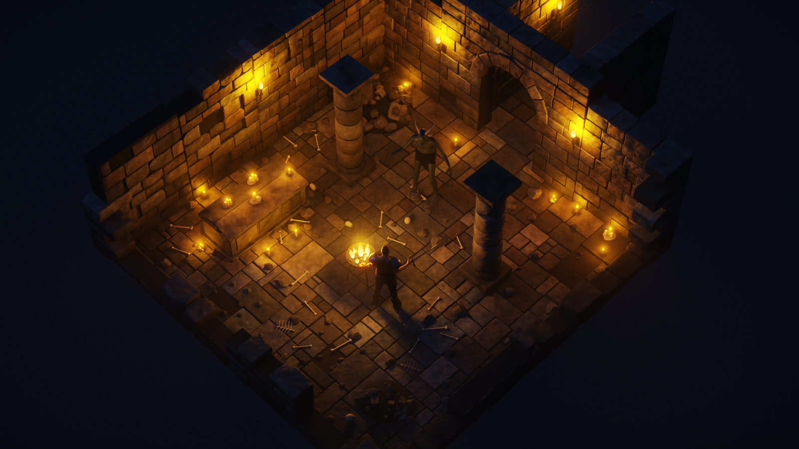
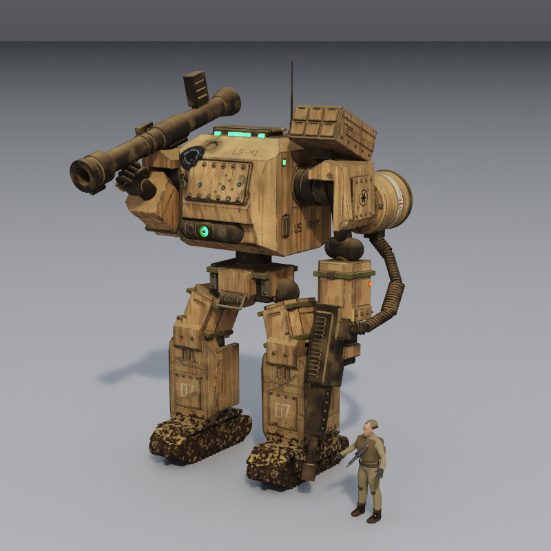
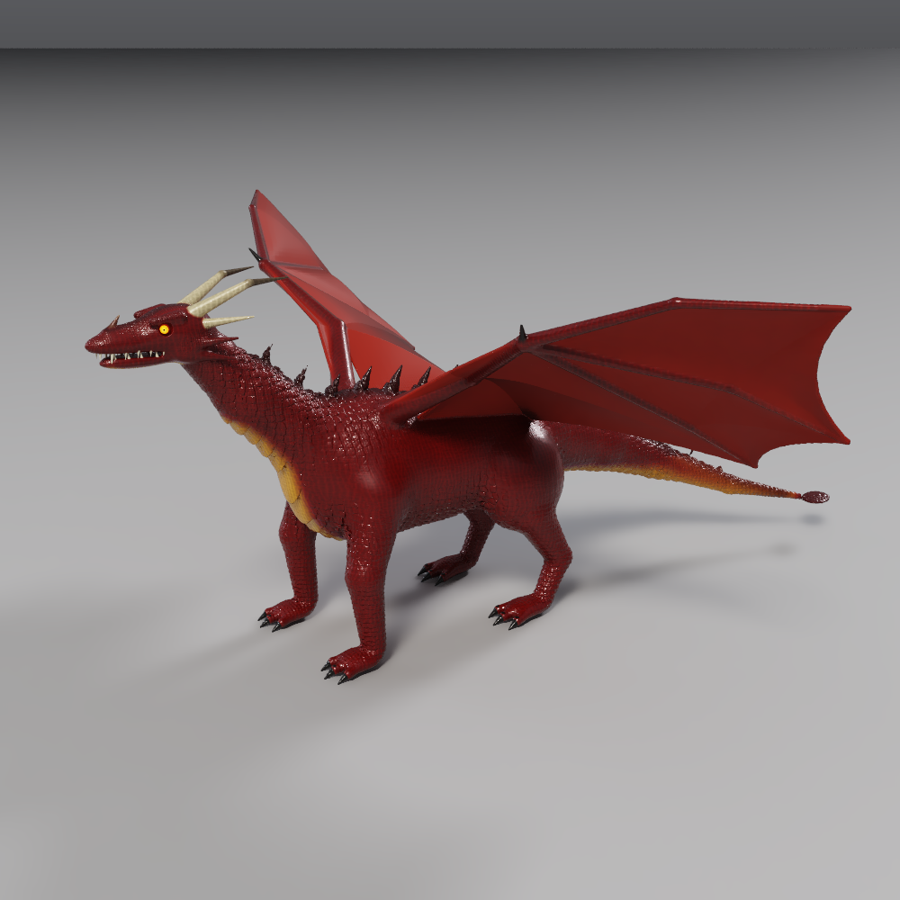
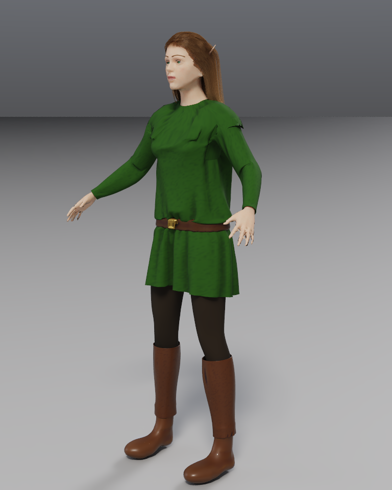
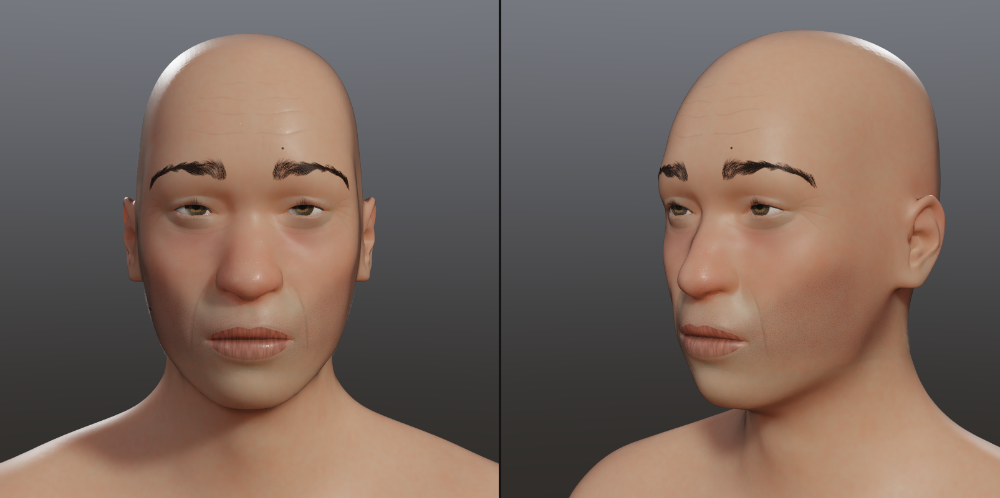
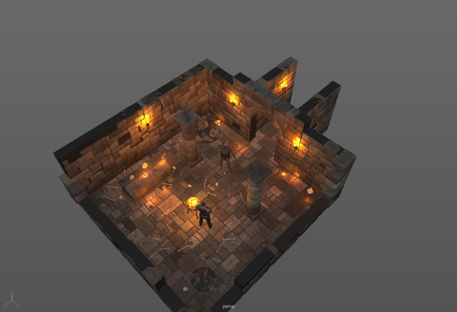
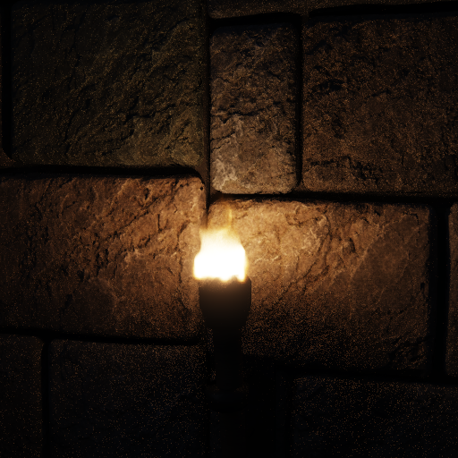

<h1 align="center">Clide3D</h1>

<p align="center">
  <b>A Maya-style 3D editor in Rust that AI agents can drive.</b><br>
  Sculpt, rig, animate, dress, weather and path-trace whole scenes by hand or
  through a built-in MCP server.
</p>

<p align="center">
  <a href="LICENSE-MIT"></a>
  
  
</p>

<p align="center">
  
  <br><sub>A dungeon crypt built through the MCP tools and rendered with the built-in path tracer.</sub>
</p>

---

## Why Clide3D?

Most 3D tools are built for a person with a mouse. Clide3D is built for both:
a familiar Maya-style desktop editor **and** a local
[Model Context Protocol](https://modelcontextprotocol.io) server that exposes
the whole editor as 56 typed tools. Point Claude Code (or any MCP client) at it
and the agent can build, inspect, render and export a scene while you watch
the window update live, then take over with the mouse at any point. Every
agent edit lands on the same undo stack as yours.

Everything is one native Rust binary: no Python runtime, no plugins, no cloud.

## Highlights

| | |
|---|---|
| **Maya-style editor** | Menu sets, shelf, Outliner, Channel Box / Attribute Editor, four-view layout, time slider, hotkey editor, and a MEL command line (`polyCube -n box; move 0 2 0`). |
| **Clay sculpting** | Signed-distance "blob" modelling (spheres, capsules, lathes, sweeps, extrusions, arrays, shells, bands) with smooth or sharp joins, plus brush sculpting, painting and decals on a fine detail layer. |
| **Hard surface** | Chamfered panels, bolts, vents and cables (`kitbash`, `detail_pass`), forged armor plates, battle damage stamps and vehicle wear presets. |
| **Characters** | A built-in human base (MakeHuman CC0 mesh, 600+ shape controls) with a full rig, face detail and facial hair, textured eyes, strand hair, and simulated, sewn garments. |
| **Rigging and animation** | Bones, weight painting, keyframe clips with smooth/linear/step keys, and posing that carries props and armor along. |
| **Smart materials** | Layered, Substance-style looks (worn iron, gold trim, old leather, dungeon stone…) over a CC0 scanned texture library, with dirt, rust, edge wear and cavity masks. |
| **Environments** | A modular dungeon kit, heightfield terrain, scatter, torch/candle/brazier lights and simulated fire and smoke. |
| **Film renderer** | A GPU path tracer (WGSL compute, with a CPU fallback) with soft studio lights, HDR skies, depth of field, motion blur, fog, bloom, film looks and denoising. |
| **Game-ready output** | Bake clay to a triangle budget with UV unwrap and texture maps, then export glTF (`.glb`) or FBX 7.4 with rigs, animation and materials. |

## Gallery

<table>
  <tr>
    <td width="50%"><br><sub>Kitbashed mech with paint wear and battle damage.</sub></td>
    <td width="50%"><br><sub>Clay dragon: adaptive scale detail and membrane wings.</sub></td>
  </tr>
  <tr>
    <td><br><sub>Human base with simulated, sewn garments and strand hair.</sub></td>
    <td><br><sub>Face folds, pores, brows and textured eyes.</sub></td>
  </tr>
  <tr>
    <td><br><sub>The same crypt in the live viewport.</sub></td>
    <td><br><sub>Simulated fire lighting displaced stone.</sub></td>
  </tr>
</table>

The pictures in the `*_check/` folders are native Clide3D renders, and each
folder includes the recipe to reproduce them (see [Testing](#testing)).

## Quick start

You need a recent stable Rust toolchain (the crate uses the 2024 edition, so
Rust 1.85 or newer) and a GPU that `wgpu` supports.

```sh
git clone https://github.com/addamb/clide3d.git
cd clide3d
cargo run --release
```

Use `--release`: sculpting, meshing and rendering are much slower in debug
builds.

> **Platform note:** Clide3D is developed and tested on macOS (Apple
> Silicon). It is built on cross-platform crates (`wgpu`, `eframe`, `rfd`), so
> Windows and Linux should work, but they are not yet tested. Reports and
> fixes are welcome.

## Driving it with an AI agent

While the editor is open it serves MCP over Streamable HTTP at
`http://127.0.0.1:7878/mcp`. It listens only on localhost and rejects
non-local browser origins.

**Claude Code**, from any folder:

```sh
claude mcp add --transport http clide3d http://127.0.0.1:7878/mcp
```

Inside this repository, `.mcp.json` already registers it. Then just ask:

> *"Build a modern Formula 1 car, give it a livery, then put it on a race
> track and render it at golden hour."*

To run several editors side by side, give each one its own port:

```sh
CLIDE3D_MCP_PORT=7879 cargo run --release
```

Any MCP client works. Under the hood each tool is a plain JSON-RPC call:

```sh
curl -s http://127.0.0.1:7878/mcp \
  -H 'content-type: application/json' \
  -d '{"jsonrpc":"2.0","id":1,"method":"tools/call",
       "params":{"name":"create_object",
                 "arguments":{"shape":"Sphere","name":"ball","translate":[0,1,0]}}}'
```

<details>
<summary><b>All 56 tools</b></summary>

| Area | Tools |
|---|---|
| Scene | `get_scene`, `new_scene`, `open_scene`, `save_scene`, `undo`, `redo`, `run_mel` |
| Objects | `create_object`, `update_object`, `delete_object`, `duplicate_object`, `select_object`, `group_objects`, `parent_objects`, `set_pivot`, `mirror_object` |
| Clay and surfaces | `edit_clay`, `get_clay`, `sculpt`, `paint`, `decal`, `surface_point` |
| Reference images | `set_reference`, `compare_reference`, `project_reference` |
| Materials and wear | `set_material`, `wear`, `damage` |
| Hard surface | `kitbash`, `detail_pass` |
| Characters | `create_human`, `set_human`, `human_controls`, `face_detail`, `face_hair`, `cloth` |
| Rigging and animation | `rig`, `pose_bone`, `animate`, `playback` |
| Environments | `kit`, `scatter`, `edit_terrain`, `fire` |
| Camera and view | `set_camera`, `frame_view`, `set_display`, `screenshot` |
| Rendering | `render_film`, `render_views`, `render_animation`, `job_status` |
| Output | `bake`, `export_glb`, `export_fbx`, `check_export` |

Long work (renders, bakes, simulations, exports) runs as cancellable
background jobs with a progress bar in the editor; `job_status` polls them.

</details>

## Using the editor

| Action | Keys |
|---|---|
| Orbit | RMB drag, or Alt + LMB |
| Pan | MMB, Shift + RMB, or Shift + scroll (two fingers on a trackpad) |
| Zoom toward the mouse | Scroll, pinch, or Alt + RMB |
| Orbit around a spot | Double-click a model |
| Select / move / rotate / scale | Q / W / E / R |
| Grid snap · edit pivot | Hold X · hold D |
| Wireframe / shaded | 4 / 5 |
| Single / four view | Space |
| Frame selected / frame all | F / A |
| Group · parent · unparent | Ctrl+G · P · Shift+P |
| Hide / show | Ctrl+H / Shift+H |
| Play animation | Alt+V |
| Undo / redo | ⌘Z / ⇧⌘Z |
| Duplicate · delete | ⌘D · ⌫ |
| Save · open | ⌘S · ⌘O |

Selection works like Maya: click, Shift-click to toggle, Ctrl-click to remove,
or drag a box; the last selected object is the lead (green). In the Outliner,
drag rows onto each other to parent them. Rebind anything in
**Windows → Settings/Preferences → Hotkey Editor**.

Scenes are saved as `.json` files.

## Documentation

The **[user guide](docs/GUIDE.md)** covers every feature in depth: sculpting
from reference images, wing membranes, materials and eyes, hair, film
renders, adaptive detail, environments, human bases and faces, animation,
garments, forged armor, kitbashing, mirroring and posing, fire and smoke,
battle damage, photographic camera looks, and export.

## How it works

```
src/
├── main.rs            window setup (eframe + wgpu)
├── app/               the editor: panels, viewport, tools, jobs, timeline, MCP tool handlers
├── mcp.rs             the MCP server (tiny_http, JSON-RPC, tool schemas)
├── scene.rs           the saved scene model
├── clay.rs            signed-distance clay → adaptive meshes
├── hard_surface.rs    extrude / lathe / sweep / shell / array / band forms
├── sculpt.rs, paint.rs, surface.rs, detail.rs, adaptive.rs
├── rig.rs, pose.rs    skeletons, skinning and posing
├── human.rs, face.rs, eyeball.rs, hair.rs, face_hair.rs
├── cloth.rs, fire.rs, damage.rs, weather.rs
├── material.rs, smart.rs   PBR materials and layered smart materials
├── render.rs          the real-time viewport renderer
├── film/              the path tracer: BVH, shading, lighting, dicing, denoise, GPU (trace.wgsl)
├── bake.rs, export_atlas.rs   game-ready meshes, UVs (xatlas) and texture maps
└── gltf.rs, fbx.rs, glb_read.rs   export and re-import checks
```

Clay objects are lists of signed-distance "blobs" that are meshed on demand,
across all CPU cores, into adaptive triangle meshes. The viewport draws them
with `wgpu`. Film renders path-trace the same meshes on the GPU when they fit
in GPU memory, and on the CPU otherwise. The MCP server runs on its own
thread and hands each call to the UI thread, so agent edits and mouse edits
share one scene, one selection and one undo history.

## Testing

```sh
cargo test --release
```

This runs 303 fast unit and integration tests. Another 39 are
`#[ignore]`d visual acceptance checks that render the pictures in the
`*_check/` folders; each folder's `README.md` says what it verifies and how to
reproduce it, for example:

```sh
cargo test --release kitbash_catalog -- --ignored --nocapture
```

## Contributing

Issues and pull requests are welcome. Before opening a PR:

1. Run `cargo test --release`, and `cargo clippy` if you have it installed.
2. If your change affects how things look, rerun the matching `*_check`
   test and include before and after pictures.
3. Keep new MCP tools typed and documented in `src/mcp.rs`, so agents can
   discover them.

## Third-party assets

- **Human base mesh and shape targets:** converted from
  [MakeHuman](https://github.com/makehumancommunity/makehuman), CC0 1.0. See
  [`assets/makehuman/LICENSE.md`](assets/makehuman/LICENSE.md).
- **Detail texture library:** from [ambientCG](https://ambientcg.com), CC0
  1.0. See [`assets/textures/LICENSE.md`](assets/textures/LICENSE.md).

Clide3D's interface is inspired by Autodesk Maya. Clide3D is an independent
project and is not affiliated with or endorsed by Autodesk. Maya is a
trademark of Autodesk, Inc.

## License

Licensed under either of

- Apache License, Version 2.0 ([LICENSE-APACHE](LICENSE-APACHE))
- MIT license ([LICENSE-MIT](LICENSE-MIT))

at your option.

Unless you explicitly state otherwise, any contribution intentionally
submitted for inclusion in the work by you, as defined in the Apache-2.0
license, shall be dual licensed as above, without any additional terms or
conditions.
