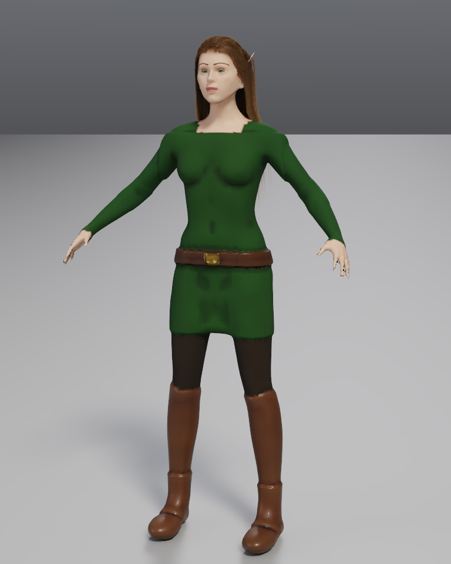
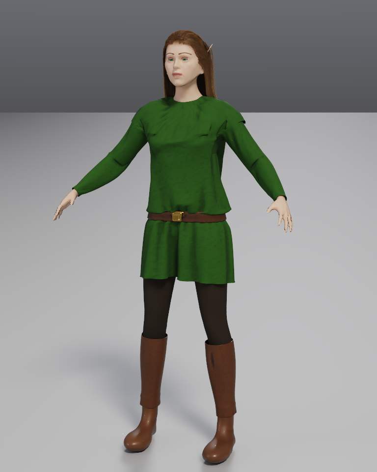

# Cloth visual checks

| Original clay covers | Connected cloth garment |
| --- | --- |
|  |  |

The replacement is one cotton tunic with connected sleeves, a fitted collar
and shoulder yoke, wrist cuffs, and a cinched waist beneath the original
leather belt and gold buckle. `mid_thigh` is the midpoint of hips and knees.
There are no separate sleeve tubes or overlapping torso/skirt hems. The
leather shafts follow the calf cross-section, use the original leather color
and material, and meet the retained clay shoes. Old clothing covers and torso
fillers are removed; the belt, buckle, leggings and shoes remain. The cover
belt is temporarily omitted during draping, then restored before the buckle
in its original blob ordering. Body detail
and paint made for the old covers are cleared; head paint remains.

The tunic uses the API defaults (resolution 56, cotton, 2 cm fit, 2 mm
thickness), with `sleeves: true`, `length: "mid_thigh"` and a belt at 1.02 m.
Shafts use resolution 40, 8 mm fit and leather. One Loop subdivision follows
simulation, with smooth normals and separately rebuilt thickness/rounded
rims. Shoulder/collar, armhole/cap and cuff anchors keep the cut on the body;
cap UV pieces share simulation seam vertices with the torso.

All pictures use **768 × 960, 64 samples, three bounces and denoising**.
The check asserts that every render finishes all 64 samples. It uses the
merged GPU film tracer (Apple M2 Max / Metal for this run), retaining the same
hair cards in each view. Body meshing is capped at 192 cells; contact uses
both the exact clay field and a bounded local guard against displayed body
triangles.

Inspect [three-quarter](after_three_quarter.png), [side](after_side.png),
[shoulder/armhole close-up](shoulder_closeup.png), and
[waist close-up](waist_closeup.png). Walk frames [00](walk_00.png),
[04](walk_04.png), [08](walk_08.png), [12](walk_12.png) and [16](walk_16.png)
sample a cache simulated consecutively at 24 fps. The sleeved upper tunic
follows transferred skin weights, with contact corrected against posed body
triangles at cached frames; the free hem below the belt simulates inertia.
This avoids the inverse field's ambiguous contact around bent elbows.

`elf_cloth.json` saves the drape and cache. `elf_cloth.glb` contains the full
geometry; [export_walk_08.png](export_walk_08.png) comes from its independent
reader, reported in [export_check.json](export_check.json).

The textured game GLB and FBX use 512-pixel preview textures and bake budgets
of 70,000 triangles for the body, 30,000 for the head, 14,000 for the connected
tunic, and 2,500 for each shaft. The whole scene is asserted below 200,000
triangles. The result contains **156,287 triangles and 106,835 vertices**.
Fine folds and weave relief are retained in normal maps. Inspect
[game_export_walk_08.png](game_export_walk_08.png) and
[game_export_check.json](game_export_check.json) for the independently loaded
geometry, textures, joint counts and exact totals. Large scenes, binaries and
FBX texture files are ignored; images, reader reports and this recipe are
tracked.

Reproduce the complete check:

```sh
CLOTH_SCENE=/absolute/path/to/elf8/elf.json cargo test --release elf_cloth_film_check -- --ignored --nocapture
```

Set `CLOTH_PREVIEW=1` for only the rest views and close-ups. GPU tracing needs
Metal access; otherwise the renderer reports its fallback to CPU.

The regular suite checks seam connectivity/manifold winding, four garment
openings, shoulder coverage on female/intermediate/male human shapes,
subdivision thickness and interpolated skin, displayed-body contact, fitted
upper-body motion with free-hem inertia, pinned-panel strain, deterministic
sphere contact, swinging-thigh skirt contact, cancellation, scene round trips,
bounded baking, and GLB/FBX cache playback inside and outside cached ranges.

Limitations: garment-to-garment contact is separate from each garment's own
self-contact. Sleeved upper pieces use skinning during animation, rather than
full elbow fabric dynamics. Animated exact-field contact still uses a local
inverse skin approximation, supplemented by the posed render mesh. Cached
exports use a joint per render vertex, including normal rotation and ordinary
skin motion outside the cache; omit caching for a compact skeletal game rig.
Reader warnings about untextured eyes and unused skeleton joints are retained
in the reports.
