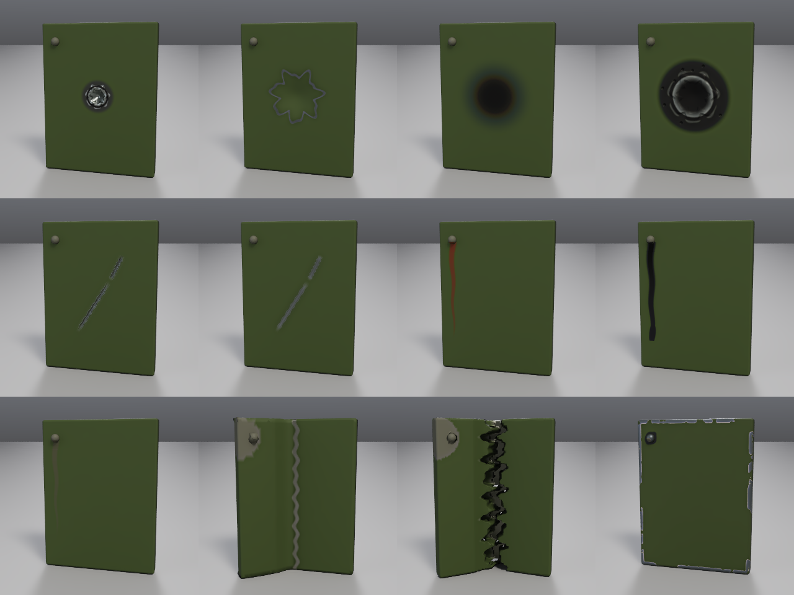
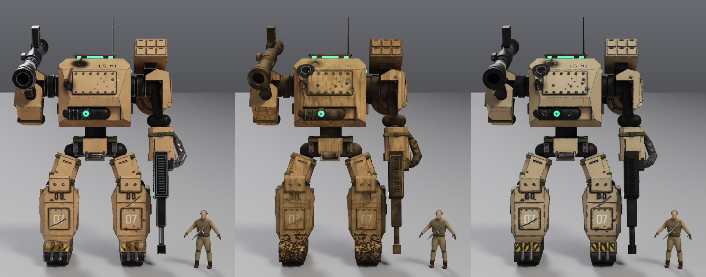
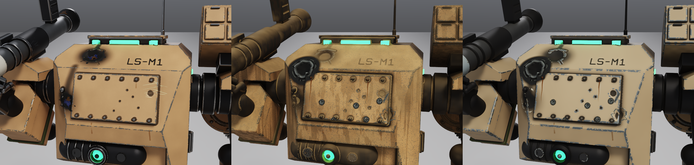
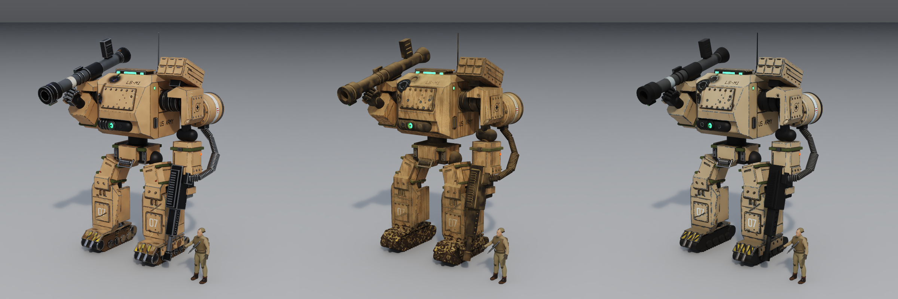

# Physical damage checks

The pictures come from the native film tracer and saved procedural damage,
using the same stamp/preset functions as the MCP `damage` tool.

## Panel sheet



Read left to right:

| Row | 1 | 2 | 3 | 4 |
| --- | --- | --- | --- | --- |
| 1 | Bullet hit | Dent | Scorch | Blast |
| 2 | Gouge | Scrape | Rust streak | Oil leak |
| 3 | Water stain | Hinge bend | Jagged tear | Battle wear |

The plate is 32 × 42 cm painted metal, with a bolt above the leak starts.
Crater/dent geometry is real; the material exposes metal at the damage.
Bend rotates a plate half about its hinge; tear opens a jagged seam. The
scorch uses soft soot rather than splat droplets. Grooves have metal-colored
fine scratches and lips. Preset chips use convex curvature, occlusion
protection and nested thresholds of coarse clusters and irregular flakes.
Light abraded paint rims surround grey steel; flat paint has no procedural
stone-chip speckling.
Individual 320 px images are also saved for closer inspection.

```sh
SAMPLES=64 cargo test --release damage_panel_films -- --ignored --nocapture
```

## Mech comparison

Columns in each comparison are **original / round two / round three**,
with identical cameras, lighting, sampling and native image resolution.







The individual round-three frames are [front](mech_after_front.png),
[detail](mech_after_damage.png), and [daylight](mech_after_daylight.png).
Round-two frames are preserved as `mech_round2_*.png`.

The harness copies the source scene to `mech_before.json` and writes an
editable `mech_after.json`; it asserts that the original file's bytes remain
unchanged. The large scene snapshots are generated locally and excluded
from Git. Cameras reconstruct the supplied front and torso-detail framing;
before and after use identical cameras, studio lighting, dimensions and
sampling. The additional 800 × 800 three-quarter pair uses an overcast sky
and warm daylight sun. The scene is shown in the rest pose (including the
soldier).
Front: 680 × 800; detail: 840 × 600; 64 samples, four bounces, denoised.

The after recipe stacks battle wear and desert dust at amount **1**,
uses world-height mud on tracks/shins, replaces workaround splat/scratch
decals while retaining stencils and emblems, and adds torso bullet hits,
a blast crater, a dent, a gouge, rust from bolts, oil on a piston, and a
shoulder dent. The source paint finish is desaturated toward sand, with
gentle large-scale variation and no scratched/pore texture on the paint.

The default presets leave flat vertical paint clean. Thin matte dust settles
on world-up surfaces and in corners; bare metal and rubber receive less
than half the dust opacity and retain their base finish. Emissive and
transmissive materials are excluded. Older procedural dirt deposits are
replaced, preventing multiple dust coats from turning dark parts brown;
painted masks, stencils and explicit damage remain.

Runoff is generated from downward-facing convex lips and concave roots in
the mesh, follows the existing gravity/surface integrator, and varies in
width, length and opacity. There are at most three paths / twelve segments
per clay object, with world-space spacing and a shared decal budget. No
whole-surface elongated noise layer or stone-chip speckle is added.
Generated drains save their preset ownership, so reapplication replaces
rather than duplicates them and `factory_new` removes them. Scene material
layers, transforms and sampling density do not change the placement seeds.

Exposed corners have clustered light worn paint and larger grey steel
flakes. Track deposits use smooth dark wet-brown coverage, cavity buildup
and restrained stone relief, with a lighter dry dust layer on tread tops.
Oil retains its dark glossy core and terminal drip. Source sculpt/detail/
paint grids are preserved, and the original scene is checked byte for byte.

```sh
DAMAGE_SCENE=/absolute/path/to/mech.json SAMPLES=64 \
  cargo test --release damage_mech_films -- --ignored --nocapture
# Optional: preserve the previous mech_after.json as mech_round2.json, then
# re-render round two as well with RERENDER_ROUND2=1.
# Re-render only the after scene during iteration:
AFTER_ONLY=1 SAMPLES=64 cargo test --release damage_mech_films -- --ignored --nocapture
```

Recipes live in `src/damage_checks.rs`. Metal is selected automatically when
available; the CPU renders the same material profiles otherwise.

## Automated checks

`damage::tests` checks deterministic placement and persistence, real crater
geometry, localized refinement for a 5.56 mm hit on coarse clay, downhill
flow on a rotated/scaled surface and drainage off bolts without jumping to
the back of a thin plate, scaled bone-attachment world normals,
preset application/replacement/removal, hinge rotation, flat panel centers,
unbaked glTF PBR grouping, and exact baked color/ORM round trips through GLB
(normal map decoding allows one byte of rounding). Paint has a regression
for single-point dabs and named-blob masks.

The film `gpu_matches_cpu_on_smart_materials` test covers all new presets,
every stamp, painted PBR channels, compiled world masks and melted scorch
relief. Unbaked glTF quantizes per-triangle roughness/metallic; clay bakes
retain the exact texture maps. Local mesh refinement is bounded; use a finer
base mesh if a very large batch exhausts its budget.

Round-three validation: **211 tests passed**, 23 manual visual tests ignored
by the automated suite. The full suite ran with native Metal available;
CPU/GPU mean 8-bit pixel errors were 0.80 for battle wear, 0.52 for desert
dust, 0.78 for the combined stack plus runoff, 0.70 for mud, and 0.48 for
continuous leaks. Release build and Clippy (`--all-targets -- -D warnings`)
are clean. The panel sheet was rendered separately at 64 samples.

All nine mech frames were re-rendered at 64 samples; the three comparison
sheets preserve their native resolution. The final mech render test passed
and confirmed that the original source scene remains byte-for-byte unchanged.
