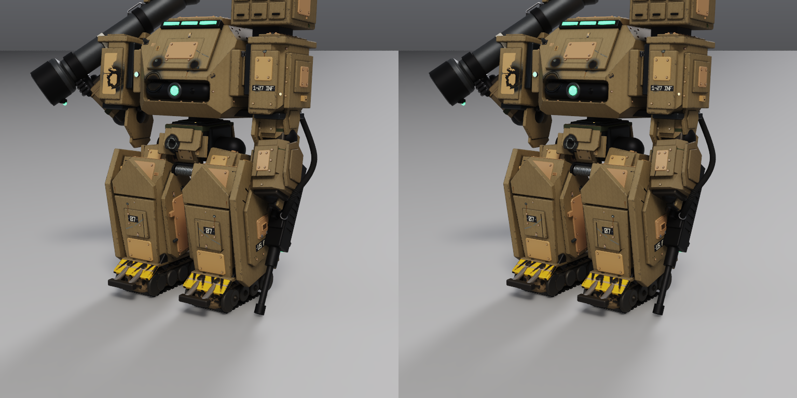

# Tool speed, materials and export packing

Reproduce with native Rust and the existing dependency set:

```sh
cp /absolute/path/to/mech3/mech.json speed_check/mech.json
cargo build --release
cargo test --release
cargo clippy --release --all-targets
cargo test --release speed_mech_acceptance -- --ignored --nocapture
```

The acceptance test reads only the copied scene. Generated scene copies and
GLBs are ignored by git. It writes timings and independent GLB-reader summaries
to `measurements.json`, exports `mech_per_part.glb` and `mech_atlas.glb`, and
renders both at animation `fire`, frame 3 with identical cameras and settings.
The two exported files retain their objects, skeletons and animation clips.

The "before" material measurement reproduces the former cache invalidation:
clear all clay/environment cache entries, change `tan_paint`, and synchronize
the entire 283-object scene. The "after" measurement changes the same shared
material with populated caches, waits for shading updates, and asserts that
no clay geometry build occurred. Both use the full copied scene, including
the surrounding environment and soldier. Elapsed times are single runs on
this workstation; concurrent editor/compiler activity can affect them.

Live MCP measurements additionally open the copy in a separate editor process
on a separate localhost port. The material edit is deliberately sent during
initial mesh builds, to exercise the former waiting-in-line case. The original
scene is never saved or modified.

## Results

Measured on 2026-10-15, using the supplied mech copy (SHA-256
`1f70224c34c979b33bc0215ce42f1b74a01754c711516509622b3330793e0c7e`).
The copy and original still have identical hashes.

| Operation | Before | After |
| --- | ---: | ---: |
| Shared `tan_paint` edit, wait for all resulting mesh data | 323.579 s | **1.991 s** |
| Clay geometry builds caused by that edit | all clay objects invalidated | **0** |
| Objects receiving refreshed clay shading | all clay objects invalidated | **19** |
| `update_object material`, Hand.L, including shading synchronization | — | **0.005 s** |
| Baked mech parts | 20 | 20 |
| Images embedded in the mech GLB | 60 | **3** |
| GLB bytes | 133,920,388 | **49,635,060** |
| Export time after baking | 0.955 s | 1.623 s |
| Checker load and `fire` frame 3 render | pass | **pass** |

The material edit is **162.5× faster** in this run. The initial complete
scene mesh build took 217.896 s. The 20 bakes took 47.965 s in total.
Packing used one 4096² color/normal/ORM set: 48 Mi pixels, below the
128 Mi-pixel checker cap. Export requested `texel_density:512`; the packer
reduced tile sizes to meet its shared-page budget.

Actual **final-build MCP text** replies, measured separately:

| Tool | UTF-8 bytes | Round trip |
| --- | ---: | ---: |
| `open_scene` | **1,657** | 0.029 s |
| `get_scene` | **1,668** | 0.797 s |
| `set_material {list:true}` | **4,524** | 0.083 s |
| `set_material` edit | **111** | **0.012 s** |

The legacy full scene listing serialized to 216,588 bytes on this copy.
The original friction log recorded 175K/220K scene replies and a
379,267-character material listing. `measurements.json` also records the
core compact scene-summary helper sizes (1,304 bytes); live MCP replies
add camera, file, selection and budget fields. Exact live replies are in
[`live_replies.json`](live_replies.json).

Both GLBs contain 168 meshes, 485,610 triangles, 523,928 vertices, 755
instanced copies, two skins, and `fire` / `idle` animations. Their posed
bounds match exactly. The independent checker reports the same pre-existing
informational warnings for both: untextured kitbash primitives use vertex
colors, and skin 0 has two unused joints. Neither file has an image/pixel
limit error.



Left: [per-part export render](mech_per_part.png). Right:
[atlas export render](mech_atlas.png). Identical three-quarter crop of the
exported mech, `fire` frame 3, 768², 64 samples, four bounces, CPU tracer,
denoising and floor enabled. The upper weapon extends beyond this crop.
The mean absolute channel difference is **0.166 / 255** (0.065% of full
scale); colors, weathering, markings and pose remain visually matched.
The renders took 28.28 s and 13.46 s respectively.

Final checks: `cargo build --release` succeeded; `cargo test --release`
passed **294 tests** (36 opt-in checks ignored); the separate full mech
acceptance test passed; `cargo clippy --release --all-targets` completed
without warnings.

## What changed

- Clay shading changes reuse vertex positions, normals, indices and skin
  weights, including existing fine geometry. Only users of the changed
  material refresh. Environment meshes retain their unweathered colors for
  material-only updates. Bakes become stale when their source shading changes.
- Default scene replies contain counts and paginated top-level summaries.
  `all`, `parent`, `target`, `filter`, `offset` and `limit` narrow reads;
  `verbose:true` requests full properties. Large text replies remain valid
  JSON and explicitly report truncation. Images remain separate MCP blocks.
- Material listing reports object, blob and part users. Large user lists show
  the first eight references and the total; filter the name and request
  `verbose:true` for all users. Rename, glob replace/merge, unused listing,
  and unused deletion update object, blob and part assignments.
- Finished job results survive dropped connections, concurrent waiters,
  repeated reads and more than 32 subsequent jobs, with 24-hour retention.
  Job listings include totals and pagination; pending states distinguish
  queued work, running work and an applied edit awaiting mesh data.
- GLB export packs baked parts into at most two 4096-square atlas sets.
  `texel_density` targets pixels per world meter and is reduced when needed
  to fit the budget. Four-pixel gutters protect tile edges, uniformly remapped
  UVs preserve tangent orientation, and resized normals are normalized.
  `atlas:false` preserves original maps. Alpha cards and tiled UVs retain
  their original textures; they consume additional checker budget. Mean
  axis scale approximates density under nonuniform transforms.
- Linked mirror copies inherit kitbash/detail passes once. Explicit mirrors
  skip sources already handled by links, and direct copy targets are reported.
- Flexible spans sag between authored route points, avoid target surfaces,
  and preserve both endpoints within the 64-point limit. Remaining sampled
  intersections produce a warning. `route:false` keeps authored routing;
  rigid pistons warn rather than bend. `action:"reattach"` changes existing
  world-space endpoints and bone attachments without replacing part settings.

## Regression coverage

The suite checks material changes without geometry builds, unchanged unrelated
meshes, material replacement/rename and unused deletion, pagination continuity,
reply sizes and JSON validity, retained job results with disconnected and
simultaneous readers, linked mirror detail, hose obstacle avoidance and sag,
piston intersection warnings, and endpoint reattachment.

The export regression bakes **22 independent parts**: the per-part GLB has
**66 images** and reproduces the checker's refusal; packing has **3 images**
and loads successfully. It checks per-part geometry, world placement, remapped
UVs and sampled texture colors after loading the GLB independently.
